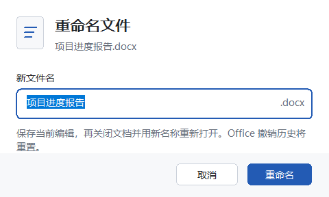
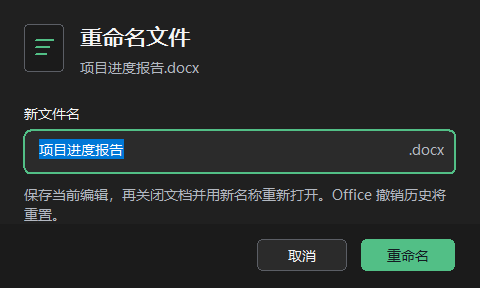

# 标签页右键重命名验证

## 使用

标签上右键 → **重命名文件…** → 输入不含扩展名的新名称 → **重命名**。Word 和 Excel 接着显示预填路径和格式的 Office 原生“另存为”。确认后可在同一个文档中继续编辑；取消时插件不会清理旧文件。Excel 可能重置撤销历史。

插件预先拒绝同名目标。Word 和 Excel 在原生窗口打开后依赖 Office 的同名确认；插件不会代为确认覆盖，也无法保证 Office 最后检查与写入之间不存在竞态。若在原生对话框中选择不同的路径或格式，或旧文件被其他程序修改或占用，插件保留旧文件。

PowerPoint 普通和 Strict `.pptx` 使用 `SaveAs` 切换到新文件名，演示文稿保持打开。Windows 先独占新名称并防止在保存期间被移动或替换。插件确认新路径、保存状态和格式后才清理旧文件。旧文件已被其他程序改动或占用时，保留原路径的文件并提示用户。

其他 PowerPoint 格式先按原格式保存当前编辑，再关闭文档。Windows 在原目录内原子改名，随后 Office 从新路径重新打开。文件已重命名但 Office 无法重开时，请从新路径手动打开。

适用于已保存、可写的文件。多窗口文档、URL 文档、仅大小写变化，以及无法可靠识别格式的 PowerPoint .pptx 文件会被拒绝。采用关闭并重开的流程时，Office 的撤销历史会重置。指向旧路径的外部链接需要在相应文档中更新。

## 自动测试

- 文件名测试覆盖扩展名、保留名称、长度、目录穿越及 UNC 路径。
- 会话测试使用模拟 Office COM、Windows 文件和 OPC 包，覆盖普通和 Strict .pptx、损坏包和格式标记不一致、保存或关闭取消、目标在保存及关闭期间才出现、原路径被替换、重开失败及偏好继承。
- 两种架构的入口为 `pwsh -File scripts/test-native.ps1 -Architecture x64` 和 `pwsh -File scripts/test-native.ps1 -Architecture x86`。

## 本机验证记录

在 Windows 上的 Office 16.0（构建 17932）中，通过测试桥调用候选源码的保存与清理函数。Word `.docx`、Excel `.xlsx` 均在同一个窗口切换到新路径，保存了原先未保存的编辑，清理了旧路径，随后再次编辑、保存成功。Excel 另存为对话框打开后创建同名文件，Office 显示替换确认；拒绝并取消后，核对原文件和冲突文件的内容均未改变。

这次实测覆盖真实 Office 的保存路径。插件菜单入口、其他 Word/Excel 格式和网络共享未做同样的实机验收。旧文件被其他程序锁定的分支由会话回归测试覆盖。

## Office 实机验收清单

使用可丢弃的示例，记录 Office 应用、构建号、位数、测试提交和 DLL 哈希。退出 Office 后核对文件和保存的内容。

1. 编辑 Word、Excel 和 PowerPoint 示例后，从前台窗口的标签右键菜单重命名。核对新路径、内容、格式、标签及其偏好，并尝试继续编辑、保存。对于应保持打开的格式，核对窗口未关闭、旧路径已清理。对于仍需重开的 PowerPoint 格式，检查窗口过渡和 Office 提示。
2. 分别使用普通和 Strict .pptx，核对重命名前后主部件的命名空间。测试宏演示文稿、模板及放映格式。
3. 测试取消、保存失败、关闭被取消、目标已存在，以及在 Office 保存或关闭期间才创建同名目标。核对原文件与冲突文件均保留。
4. 测试无法识别的 .pptx、多窗口文档、未保存或只读文档、Office 忙、仅大小写变化，以及文件成功改名后重开失败。
5. 检查中文和英文、键盘、缩放、高对比度、网络共享及重开后的分组、宽度、锁定状态和最近关闭记录。

## 原生弹窗预览

`src/rename-dialog.h` 使用原生 EDIT / BUTTON / STATIC 控件，提供浅色、深色、应用强调色及中英文界面。扩展名单独显示，不进入编辑框；输入初始选中文件名。字号和布局跟随 DPI，按钮保留焦点提示，并使用系统高对比度配色。

```powershell
pwsh -NoProfile -File scripts/preview-rename-dialog.ps1
```

此脚本编译当前 x64 源码，并运行 `tests/rename-dialog-preview.cpp`：将测试弹窗放到屏幕外且不激活，导出浅色中文、深色中文和英文预览，检查控件边界、编辑长度和默认按钮绘制。它不会启动 Office，也不会操作用户文档。输出位于忽略的 `artifacts/`。





活动选择测试在重置默认设置时保留测试存储目录，避免刷新从真实用户配置加载强调线等外观偏好。此问题已在未修改的上游代码中复现，修正仅隔离测试配置，不更改插件行为。
